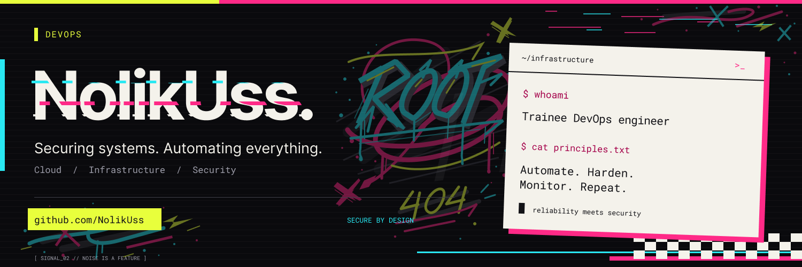
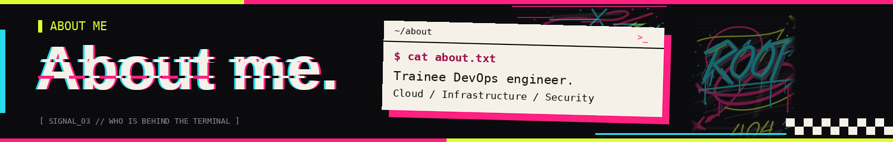
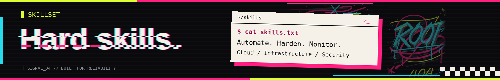
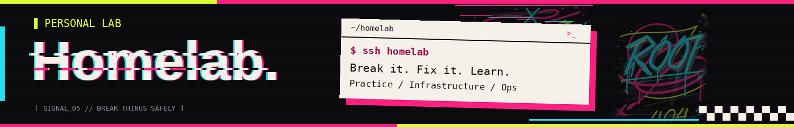
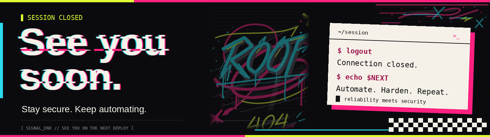

<p align="center">
  
</p>

<h1 align="center">Привет, я Трофим 👋</h1>

```bash
$ whoami
nolikuss — начинающий DevOps-инженер

$ cat status.txt
studying : Информационная безопасность @ДВФУ
focus    : инфраструктура • автоматизация • безопасность
open_to  : стажировки • проекты • практика
```

<p align="center">
  
</p>

Я учусь на 1 курсе направления «Информационная безопасность» в ДВФУ по профилю «Организация и технологии защиты информации». Мой путь в IT начинался с интереса к бэкенд-разработке, что дало мне понимание архитектуры приложений и логики написания кода.

Сегодня мой основной фокус сместился на DevOps и системную инженерию. Я практикуюсь в создании, автоматизации и обслуживании инфраструктуры, которая позволяет быстро, надежно и безопасно доставлять код от разработки до работающего сервиса.

Для меня DevOps - это идеальное пересечение разработки, системного администрирования и безопасности. Я открыт к интересным задачам, стажировкам и проектам, где можно применять знания на практике, расти как инженер и создавать надежные технические решения.

--- 
<p align="center">
  
</p>

I’m trying to update the stack as I learn more.

```python
tech_stack = {
    "languages_and_scripting": ["Bash", "Python", "C++", "YAML / JSON"],
    "os_and_networking": [
        "Linux (Ubuntu/Debian)", "Systemd", "SSH Hardening", 
        "TCP/IP", "DNS", "HTTP/S", "Nginx / Reverse Proxies"
    ],
    "containers_and_orchestration": [
        "Docker", "Docker Compose", "Multi-stage Builds" 
    ],
    "iac_and_cicd": [
        "Ansible", "Terraform (Basics)", "GitHub Actions"
    ],
    "databases_and_streaming": [
        "PostgreSQL", "Backup & Recovery"
    ],
    "security_and_secrets": [
        "SSL/TLS (Certbot)", "IAM / RBAC", "Least Privilege"
    ],
    "observability_and_logging": [
        "Grafana", "Prometheus", "Loki", "Alertmanager"
    ]
}
```
---
<p align="center">
  
</p>

Личная виртуалка, на которой я практикуюсь в администрировании и эксплуатации сервисов «как в продакшене».

| Сервис | Зачем нужен |
| --- | --- |
| **Grafana + Prometheus** | мониторинг нагрузки виртуалки: CPU, память, диск, сеть |
| **Plane** | трекер задач: сюда я записываю учебные и рабочие задачи |
| **Семейное облако** | у каждого члена семьи своё хранилище; фото выгружаются автоматически, как в iCloud, а система показывает, какие люди на каких фотографиях |

```bash
$ cat roadmap.txt
[ ] ультимативная панель: всё для учёбы и работы в одном месте
[ ] удалённая компиляция кода
```

---

--- 
## 📬 Connect with me

[](https://t.me/NolikUss) &emsp;&emsp; [](mailto:trofgorbatko@gmail.com) &emsp;&emsp; [](https://github.com/NolikUss)

> Быстрее всего отвечаю в **Telegram**

---

<p align="center">
  
</p>
